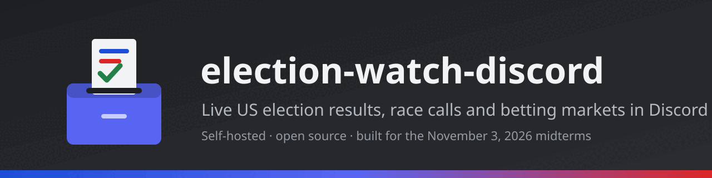
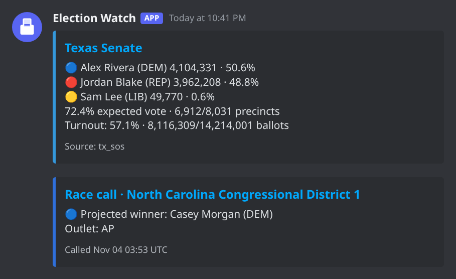
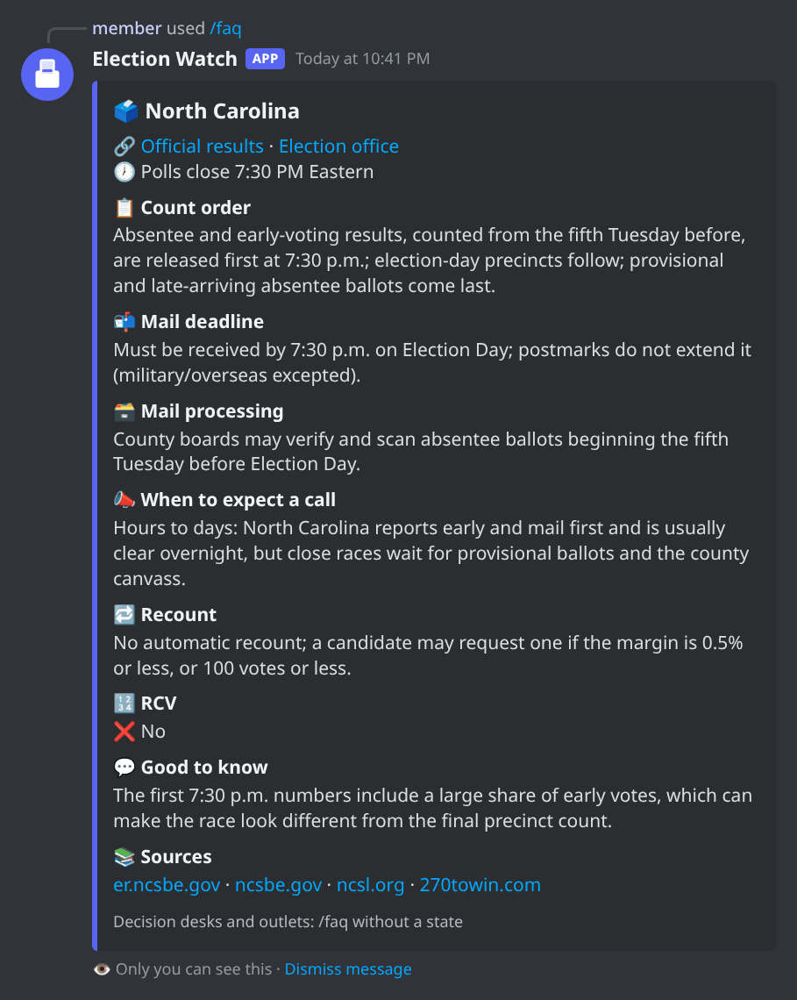
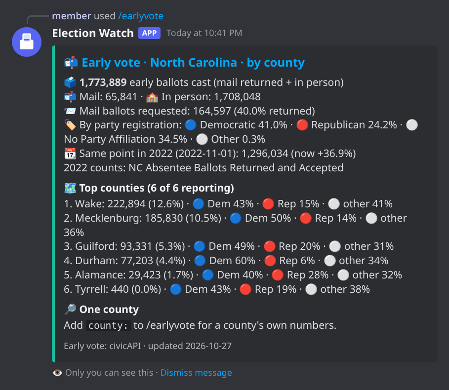
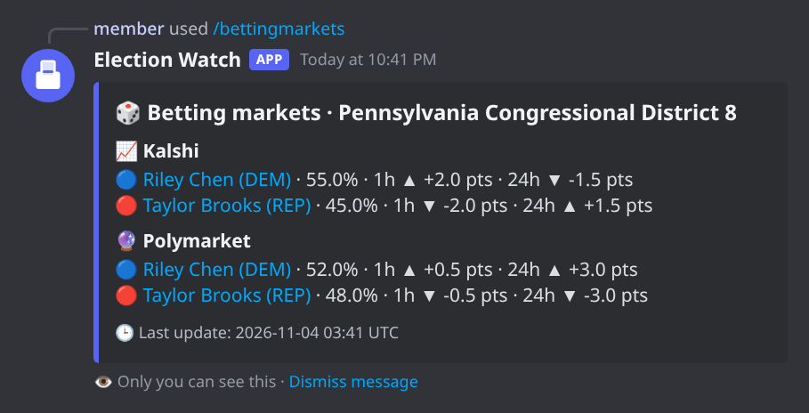
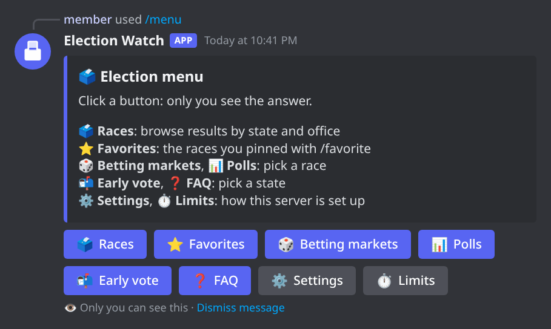

# election-watch-discord

<p align="center">
  
</p>

<p align="center">
  <strong>Live US election results, race calls and betting markets, posted straight to Discord.</strong>
</p>

<p align="center">
  <a href="https://github.com/IEatDirtySocksForFun/election-watch-discord/actions/workflows/ci.yml"></a>
  <a href="https://github.com/IEatDirtySocksForFun/election-watch-discord/actions/workflows/lint.yml"></a>
  <a href="LICENSE"></a>
  
  
  
</p>

A self-hosted Discord bot for US election night, built for the **November 3, 2026 midterms**.
The bot posts live results for the races a server follows, race calls from the outlets the
server trusts, turnout and big betting-market swings. Every member also gets a private race
browser with betting markets, polls, early-vote numbers and a voting FAQ for every state. The
project is a template: fork it, trim it, extend it.

<p align="center">
  
  <br>
  <sub>Results and race-call posts in the election channel (sample data, fictional candidates).</sub>
</p>

## 📑 Contents

- [✨ Features](#-features)
- [🖼️ Screenshots](#️-screenshots)
- [🧰 Tech stack](#-tech-stack)
- [🚀 Getting started](#-getting-started)
- [📖 Usage](#-usage)
- [⚙️ Configuration](#️-configuration)
- [🗳️ Election night checklist](#️-election-night-checklist)
- [📡 Where the numbers come from](#-where-the-numbers-come-from)
- [🧠 How it works](#-how-it-works)
- [💡 Good to know](#-good-to-know)
- [🔒 Privacy](#-privacy)
- [🛠️ Troubleshooting](#️-troubleshooting)
- [🤝 Contributing](#-contributing)
- [📄 License](#-license)
- [📚 See also](#-see-also)

---

## ✨ Features

- **Live results** for every watched race, from official state and county feeds (40 states +
  DC), with [civicAPI](https://civicapi.org) filling in every state. Each post shows the top
  five candidates, party markers, expected vote, precincts and turnout.
- **Sensible posting.** By default a race is posted at most every 5 minutes, and only when its
  numbers change. Admins can switch to every _N_ minutes or to every single update.
- **Race calls** from the outlets each server picks: AP, DDHQ, CNN, NBC, CBS, Fox, ABC, or
  civicAPI's own decision desk. Retracted calls get a separate post.
- **Betting markets.** Kalshi and Polymarket odds for every watched race, with candidate names,
  1 h and 24 h moves, and optional swing alerts tuned per race or per kind of race.
- **Polls.** The latest public polls for a race, with partisan internals flagged.
- **Early vote.** Ballots cast before Election Day for the 46 states civicAPI tracks: mail and
  in person, party, age, a party split for every county, one county on its own, and a
  comparison with the last similar election.
- **Private race browser** (`/races`): tabs for House, Senate, state and local races, a state
  picker, favorites, and Betting markets and Polls buttons on every race.
- **Button menus.** `/menu` opens every tool as buttons; admins can also post a permanent menu
  in a channel with `/menu_post`.
- **Voting FAQ** for all 50 states + DC: poll closing times, count order, mail deadlines,
  recount rules, ranked-choice voting and typical call times, each with official sources.
- **Forgiving input.** `pa 08`, `PA08`, `pennsylvania-08`, `Penn. 8` and even `pensylvania 08`
  all mean `PA-08`. State names, abbreviations and close misspellings work everywhere.
- **Polite to its sources.** Each site gets at most half of its published rate limit, whether
  commands read the database (the default) or fetch live (`EW_COMMAND_DATA=live`).
- **Embeds with emoji** on every command, private replies, and Discord's size limits checked in
  the tests.
- **Tested on real election nights.** A replay sandbox reruns the 2014–2024 nights minute by
  minute through the real bot. `make sim` runs a short one in about 15 seconds.
- **No AI inside.** Plain, deterministic code: every summary comes from parsing, not a model.

---

## 🖼️ Screenshots

All screenshots are rendered from the bot's own embed builders. The betting-market numbers and
candidate names are made up; the early-vote numbers come from the saved civicAPI responses in
the test fixtures.

| `/faq state:North Carolina`                                                                                                                                                                                                                                  | `/earlyvote state:NC breakdown:county`                                                                                                                                                                                                                                                               |
| ------------------------------------------------------------------------------------------------------------------------------------------------------------------------------------------------------------------------------------------------------------ | ---------------------------------------------------------------------------------------------------------------------------------------------------------------------------------------------------------------------------------------------------------------------------------------------------- |
|  |  |

| `/bettingmarkets race:pa 08`                                                                                                                                                                                                                       | `/menu`                                                                                                                                                             |
| -------------------------------------------------------------------------------------------------------------------------------------------------------------------------------------------------------------------------------------------------- | ------------------------------------------------------------------------------------------------------------------------------------------------------------------- |
|  |  |

---

## 🧰 Tech stack

| Layer             | Choice                                                                                                                  |
| ----------------- | ----------------------------------------------------------------------------------------------------------------------- |
| Language          | Python 3.11+ (CI runs 3.11 and 3.12)                                                                                    |
| Discord           | [discord.py](https://github.com/Rapptz/discord.py) 2.x: slash commands, embeds, buttons, persistent views               |
| Database          | MongoDB through [PyMongo](https://pymongo.readthedocs.io/)'s native asyncio client (Atlas free tier or a local server)  |
| HTTP              | [httpx](https://www.python-httpx.org/) (async)                                                                          |
| Parsing           | [PyYAML](https://pyyaml.org/) for config and data files, [selectolax](https://github.com/rushter/selectolax) for HTML   |
| Tests and tooling | pytest, pytest-asyncio, [respx](https://lundberg.github.io/respx/) (HTTP mocks), ruff, Prettier, GitHub Actions, CodeQL |

---

## 🚀 Getting started

### Prerequisites

- **Python 3.11 or newer** and `git`.
- **A Discord account** with permission to add a bot to a server (Manage Server).
- **MongoDB**: a free [Atlas](https://www.mongodb.com/atlas) cluster, or a local server:

  ```bash
  docker run -d -p 27017:27017 mongo:8.0
  ```

- Optional: `make` (every recipe also has a plain `python`/`pytest` form in
  [tests/README.md](tests/README.md)) and `npm` (only for the Markdown linter).

Setup takes about ten minutes.

### Installation

1. **Create the bot.** At <https://discord.com/developers/applications>, click _New
   Application_, then _Bot_ → _Reset Token_, and copy the token. No privileged intents are
   needed.
2. **Invite the bot.** Under _OAuth2 → URL Generator_, tick the `bot` and
   `applications.commands` scopes, then these permissions: **View Channels, Send Messages,
   Embed Links, Read Message History**. Open the generated URL and pick the server.
3. **Get the code.**

   ```bash
   git clone https://github.com/IEatDirtySocksForFun/election-watch-discord
   cd election-watch-discord
   make install          # or: python3 -m venv .venv && .venv/bin/pip install -e ".[dev]"
   cp .env.example .env
   ```

4. **Fill in `.env`.** Only two lines are required:

   ```env
   DISCORD_TOKEN=the-bot-token
   MONGODB_URI=mongodb://127.0.0.1:27017      # or an Atlas mongodb+srv://… URI
   ```

   While testing, also set `DEV_GUILD_ID` to the test server's ID so slash commands appear
   there instantly. Every other setting is optional; see [Configuration](#️-configuration).

5. **Check the setup, then start the bot.**

   ```bash
   .venv/bin/python -m electionwatch --check   # checks .env, MongoDB and the race list, then exits
   .venv/bin/python -m electionwatch           # starts the bot
   ```

6. **Configure the server in Discord.** Run `/setup channel:#election-night`, then
   `/watch action:add race:<race>` for each race to follow (autocomplete helps). Until a server
   adds its own races, it follows the default list in `config/races.yaml`.

Results start flowing as soon as the states publish results.

> **Note:** most 2026 results feeds only go live on election day. Before then, the channel stays
> quiet while betting markets, polls, early vote and the FAQ already work.

---

## 📖 Usage

Replies to commands are private: only the person who ran the command sees the reply. Posts in
the election channel are public.

### Commands for everyone

| Command                                   | What it does                                                                         |
| ----------------------------------------- | ------------------------------------------------------------------------------------ |
| `/races`                                  | private race browser: results by state and office, with favorites                    |
| `/bettingmarkets [race]`                  | Kalshi and Polymarket odds with candidate names and 1 h / 24 h moves                 |
| `/polls race:<race> [count] [internals]`  | the latest polls for a race                                                          |
| `/earlyvote [state] [breakdown] [county]` | early-vote numbers: party, method, age, counties, or one county with its party split |
| `/faq [state]`                            | a state's voting FAQ, or the list of states and decision desks                       |
| `/favorite add·remove <race>`             | pin races in the browser                                                             |
| `/watch list`                             | the races this server follows                                                        |
| `/bettingalerts`                          | this server's betting-market alert settings                                          |
| `/settings`                               | this server's settings                                                               |
| `/limits`                                 | how often data refreshes, and this server's command limits                           |
| `/menu`                                   | every tool above as buttons                                                          |

`/bettingmarkets` and `/polls` also work in direct messages, using the default race list.

### Commands for admins

Admins are members with **Manage Server**, or with the admin role chosen in `/setup`.

| Command                                                      | What it does                                                                   |
| ------------------------------------------------------------ | ------------------------------------------------------------------------------ |
| `/setup channel:<#channel> [admin_role]`                     | where the bot posts, and who else may configure it                             |
| `/watch add·remove <race>`                                   | the races the server follows                                                   |
| `/posting mode:<default·interval·immediate> [minutes]`       | how often results are posted                                                   |
| `/calls outlets:<…> enabled:on·off`                          | which outlets' race calls are posted                                           |
| `/bettingalerts on·off [threshold] [window] [race·category]` | alerts on big betting-market swings, server-wide, per race or per kind of race |
| `/turnout on·off`, `/exitpolls on·off`                       | turnout lines and exit-poll links                                              |
| `/earlyvote_posts on·off`                                    | a daily early-vote summary for the watched races                               |
| `/pause`, `/resume`                                          | stop and restart all posting                                                   |
| `/refresh [what]`                                            | fetch fresh data now: `all`, `results`, `odds`, `polls`, `earlyvote`, `races`  |
| `/limits [user_cooldown] [user_hourly] [refresh_cooldown]`   | change this server's command limits (`-1` restores the default)                |
| `/menu_post [channel]`, `/menu_remove`                       | post a button menu anyone can click (posting again replaces it)                |
| `/menu_private on·off`                                       | whether members can open a private `/menu` (on by default)                     |

### Examples

```text
/watch action:add race:pa 08                 → follows PA-08
/bettingmarkets race:Texas Senate            → Kalshi and Polymarket odds for TX SEN
/earlyvote state:north carolina county:durham
/faq state:Penn.                             → the Pennsylvania FAQ
/bettingalerts enabled:on category:house threshold:5 window:30
/menu_post channel:#election-night
```

### Betting-market alerts

Alerts can be tuned for one race (`race:PA-08`) or for a kind of race (`category:` senate,
house, statewide, state-senate, state-house, mayor or local). A race setting beats its
category's, which beats the server-wide one, and any value left out comes from the next level
down. `enabled:default` removes an override. Only watched races alert, and a server can keep up
to 100 race overrides.

### Race keys

Races can be typed in plain English (`Texas Senate`, `North Carolina Congressional District 1`)
or as short keys:

| Key                            | Race                                                              |
| ------------------------------ | ----------------------------------------------------------------- |
| `NC-01`, `AK-AL`               | US House district (`AL` = at-large)                               |
| `TX SEN`, `OH SEN S`           | US Senate (`S` = special election, e.g. Ohio and Florida in 2026) |
| `GA GOV`, `AZ AG`              | a statewide office (`GOV`, `LTGOV`, `AG`, `SOS`, `TREAS`, …)      |
| `TX SD-05`, `TX HD-121`        | state senate / state house district                               |
| `TX LOCAL harris-county-judge` | a local race                                                      |
| `PR-AL`, `GU GOV`              | territories                                                       |

Commands accept the state and district in any common form: `pa 08`, `PA08`, `pennsylvania-08`,
`Penn. 8` and `pensylvania 08` all mean `PA-08`. `/faq` and `/earlyvote` take a state's code,
name, abbreviation (`N.C.`, `Calif.`) or a close misspelling. The data files
(`config/races.yaml`) and the feeds stay strict.

Parties get markers: 🔵 Democratic · 🔴 Republican · 🟡 Libertarian · 🟢 Green · 📜
Constitution · ⚪ independent or no party, plus a marker each for 97 smaller parties. See
[docs/parties.md](docs/parties.md), and edit `electionwatch/data/parties.yaml` to change any.

---

## ⚙️ Configuration

Settings come from environment variables, read from `.env` (or the comma-separated files in
`EW_ENV_FILES`). Real environment variables always win over the files. Both `KEY=value` and
`KEY: value` lines work. `.env.example` lists every setting with a comment.

> **Warning:** leave optional settings commented out unless needed. An empty value is still a
> value.

### Required

| Variable        | Purpose                                         |
| --------------- | ----------------------------------------------- |
| `DISCORD_TOKEN` | the bot token from the Discord developer portal |
| `MONGODB_URI`   | MongoDB connection string (local or Atlas)      |

### Optional

| Variable                           | Default                  | Purpose                                                                                   |
| ---------------------------------- | ------------------------ | ----------------------------------------------------------------------------------------- |
| `MONGODB_DB`                       | `electionwatch`          | database name                                                                             |
| `DEV_GUILD_ID`                     | empty                    | register slash commands instantly in one test server instead of globally                  |
| `EW_ENV_FILES`                     | `.env`                   | comma-separated env files to read                                                         |
| `LOG_LEVEL`                        | `INFO`                   | Python logging level                                                                      |
| `AP_API_KEY`, `DDHQ_API_KEY`       | empty                    | paid race-call feeds; each adapter is skipped without its key                             |
| `EW_ENABLED_SOURCES`               | empty                    | opt in to adapters that are off by default (scrapers, national fallbacks, outlet calls)   |
| `EW_DISABLED_SOURCES`              | empty                    | turn off adapters that are on by default                                                  |
| `EW_SOURCE_STATES`                 | empty                    | limit an adapter to some states: `name=ST,ST;name2=ST`                                    |
| `EW_COMMAND_DATA`                  | `db`                     | `db`: commands read MongoDB only. `live`: commands may also fetch from the source         |
| `EW_LIVE_MAX_AGE`                  | `60`                     | live mode: seconds an answer is reused before fetching again                              |
| `EW_LIVE_TIMEOUT`                  | `10`                     | live mode: longest wait, in seconds, for a fetch before the stored answer is used         |
| `EW_RATE_SAFETY`                   | `2`                      | use at most 1/N of each host's published rate limit                                       |
| `EW_RATE_LIMITS`                   | built in                 | per-host limits, e.g. `civicapi.org=600/60` (requests/seconds)                            |
| `EW_INTERVALS`                     | computed                 | refresh intervals in seconds by kind, source or `source:kind`, e.g. `odds=120,polls=1800` |
| `EW_USER_COOLDOWN`                 | 2 × the data's refresh   | seconds before one user can repeat a command for the same race or state                   |
| `EW_USER_HOURLY`                   | `0` (no cap)             | data commands per user per hour                                                           |
| `EW_REFRESH_COOLDOWN`              | 2 × the shortest refresh | seconds between two `/refresh` runs in a server                                           |
| `EW_DEMAND_MAX`, `EW_DEMAND_HOURS` | `200`, `24`              | cap and lifetime of the list of unwatched races that commands asked for                   |
| `ELECTION_DATE`                    | `2026-11-03`             | the election the results adapters track                                                   |
| `EW_RACES_FILE`                    | `config/races.yaml`      | the default watch list for new servers                                                    |

Per-adapter feed overrides are documented in each adapter's module docstring and in
[docs/sources-results.md](docs/sources-results.md): `CLARITY_FEEDS`, `ENHANCED_VOTING_FEEDS`,
`MI_CLARITY_FEEDS`, `NJ_COUNTY_FEEDS`, `TX_COUNTY_FEEDS`, `TX_HARRIS_CODE`, `TN_COUNTY_FEEDS`,
`AL_COUNTY_FEEDS`, `IL_ELECTION_ID`, `MT_EID`, `SD_EID`.

### Files

| File                              | Purpose                                                                             |
| --------------------------------- | ----------------------------------------------------------------------------------- |
| `config/races.yaml`               | the default watch list (`election_date` plus `important:` races with key and label) |
| `electionwatch/data/parties.yaml` | party names, abbreviations and markers                                              |
| `electionwatch/faq/states.yaml`   | the per-state voting FAQ behind `/faq`                                              |
| `electionwatch/faq/outlets.yaml`  | decision desks and outlets, with results and voter-survey links                     |

Refresh rates, limits, live mode and adding a source are covered in
[docs/customizing.md](docs/customizing.md).

---

## 🗳️ Election night checklist

- **Turn on the extra sources needed.** Out of the box the bot only reads official feeds and free
  APIs. The national fallbacks and outlet calls read news sites' public data, so those adapters
  stay off until enabled. Check each site's terms first: Fox's election feed, for one, asks bots
  not to crawl it (`robots.txt`). For example:

  ```env
  EW_ENABLED_SOURCES=cbs_results,fox_results,nbc,cbs,fox,abc,cnn_exit_polls,270towin,wikipedia
  ```

  Without that line, results still come from the states and civicAPI. No race calls are posted
  (AP and DDHQ need a paid key), but civicAPI's free calls are one command away:
  `/calls outlets:CIVICAPI enabled:on`.

- **On the morning,** run `make health` to see which sources answer. civicAPI rows say `TEST`
  while civicAPI still serves practice data, and switch to `OK` once real returns arrive. In
  Discord, `/limits` shows how often each source is asked.
- **Watch a few races, not hundreds.** A busy channel takes about five messages every five
  seconds, so the default 5-minute posting mode is the safe choice.

---

## 📡 Where the numbers come from

| Coverage                              | States                                                                                                                                          |
| ------------------------------------- | ----------------------------------------------------------------------------------------------------------------------------------------------- |
| The state's own election-night feed   | AR, AZ, CA, CO, CT, DC, DE, FL, GA, HI, IA, ID, IL, IN, KS, LA, MD, MN, MT, NC, ND, NE (opt-in), NM, OH, OR, PA, RI, SC, SD, UT, VA, VT, WA, WV |
| County feeds only (part of the state) | TX (20 counties, about half the vote), MI, WI (opt-in), NJ, MO, NY (opt-in), TN, AL                                                             |
| No official feed the bot can reach    | KY, MA, ME, MS, NH, NV, OK, WY: civicAPI, plus the national fallbacks when enabled                                                              |
| [civicAPI](https://civicapi.org)      | every state + DC, from federal races down to local ones; fills all the gaps above                                                               |

Official feeds always win. civicAPI is a free results API that aggregates state and county
returns. The bot uses civicAPI only for races no official feed answered, and every post that
uses civicAPI links back to it. In checks against official results civicAPI matched closely,
and the winners always agreed. Still, treat its numbers as election-night numbers, not
certified totals (details in [docs/civicapi-accuracy.md](docs/civicapi-accuracy.md)).

Other data:

- **Betting markets:** the Kalshi and Polymarket public APIs.
- **Polls:** VoteHub, plus 270toWin and Wikipedia when enabled; partisan internals are flagged.
- **Early vote:** civicAPI, county level only (no congressional or legislative districts).
- **FAQ:** official state election sites, NCSL and the other sources listed in each state's
  entry.

Per-state notes live in [docs/sources-results.md](docs/sources-results.md) and
[docs/state-coverage-plan.md](docs/state-coverage-plan.md); polls and signals in
[docs/sources-polls.md](docs/sources-polls.md) and
[docs/sources-signals.md](docs/sources-signals.md).

---

## 🧠 How it works

```text
 every 60 s ─► Poller.tick()        each source only when its turn and its rate budget allow
                ├─ results adapters ─► MongoDB: latest numbers + history, change detection
                ├─ race calls       ─► new calls only
                ├─ betting markets  ─► MongoDB odds history, swing alerts
                └─ polls            ─► MongoDB (every 30 min)
                          │
            per server: posting rule, outlets, thresholds
                          ▼
              posts in #election-night

 every hour ─► early-vote refresher ─► MongoDB
 every 60 s ─► race-list refresher  ─► MongoDB (a few states at a time)

 slash commands ─► MongoDB                        (EW_COMMAND_DATA=db, the default)
                └► the source, within the budgets (EW_COMMAND_DATA=live, answers over 60 s old)
 autocomplete   ─► MongoDB only (Discord allows less than 3 s)
```

- **Rate budgets.** Every host gets at most half of its published rate limit per hour, shared
  by the sources that use the host. Live command fetches count against the same allowance, and
  a crowd asking about the same race shares one fetch.
- **Stable sources.** When a results source is slow or failing, its last answer stands in for
  up to 10 minutes, so posts do not flip between sources.
- **Demand.** A command for a race nobody watches queues that race for the next background
  refresh (capped by `EW_DEMAND_MAX`).

Every rate and limit can be changed: see
[docs/customizing.md](docs/customizing.md#refresh-rates-and-limits).

---

## 💡 Good to know

- **Most 2026 feeds go live on election day.** The bot finds the feeds automatically where a state
  allows it. A few need a value set by hand (`CLARITY_FEEDS`, `MT_EID`, `SD_EID`); see
  `.env.example`.
- **Feeds can change without warning.** When a state renames a field on the night, that one
  source stops and everything else keeps going.
- **The bot never gets around bot checks.** Sites behind Cloudflare challenges and the like are
  skipped, which is why a few states rely on civicAPI.
- **AP and DDHQ calls cost money.** The adapters are ready but stay off without a key.
- **Outlet call times are approximate.** Most outlets do not publish the exact moment of a call.
- **Exit polls are links** to the outlet's page, not summaries.
- **Turnout only shows where a feed publishes registered voters** (NC, GA, FL and a few others).
- **Multi-seat races show the top five candidates.**
- **Refresh rates follow each source's limits.** Results and calls refresh about every minute,
  county feeds that share a host about every 2 minutes, polls every 30 minutes and early vote
  hourly. `/limits` shows the live numbers.
- **The bot is not an official source.** The numbers are only as good as the feeds, and calls
  come from the outlets that made the calls.

---

## 🔒 Privacy

The bot stores only what it needs, in the operator's own MongoDB:

- **Per server:** the posting channel, the admin role, the watched races, the settings and the
  location of a posted menu.
- **Per user** (only after using the browser or `/favorite`): the Discord user ID, favorite
  races, home state and the last browser tab.

The bot does not read messages (no message-content intent) and keeps no analytics. Cooldowns
live in memory and vanish on restart. Requests to data sources carry the bot's name and a link
to this project, nothing about the server or its members.

Stored settings stay until deleted; there is no automatic expiry. To honor a deletion request,
remove the member's document from the `users` collection (`_id` is the Discord user ID), or a
server's from `guilds`. Members can see the server's bot settings with `/settings`, and the
public refresh rates with `/limits`.

---

## 🛠️ Troubleshooting

- **The slash commands do not show up.** Global commands can take a while to appear. Set
  `DEV_GUILD_ID` to the server's ID and restart: commands register there instantly.
- **`--check` fails on MongoDB.** Make sure the server is running. For Atlas, add the bot
  machine's IP to the cluster's access list.
- **No results yet.** Before polls close, that is normal. Run `make health` to see what each
  source answers right now.
- **A race says it is "queued".** Nobody was watching that race, so the next refresh fetches it.
  Try again in a minute or two.
- **A command says to wait.** Per-user cooldowns follow each data source's refresh rate; admins
  can change the limits with `/limits`.

---

## 🤝 Contributing

Contributions are welcome, from typo fixes to new state feeds. Start with
[AGENTS.md](AGENTS.md) (the short rules), [tests/README.md](tests/README.md) and
[docs/testing.md](docs/testing.md). The usual loop:

```bash
make test      # unit tests, no network, about 20 seconds
make sim       # a quick election-night simulation
make lint      # what CI checks (make format fixes most of it)
```

Adding a data source is one module under `electionwatch/sources/` plus a test against a saved
real response; [docs/customizing.md](docs/customizing.md) walks through the steps. Pull
requests use the [PR template](.github/pull_request_template.md).

> **Security:** report vulnerabilities privately, as described in [SECURITY.md](SECURITY.md).

---

## 📄 License

[MIT](LICENSE). The election data belongs to its publishers, and following the terms of any
source that gets enabled is the operator's responsibility.

---

## 📚 See also

- [docs/customizing.md](docs/customizing.md): refresh rates, limits, live mode, adding sources
- [docs/sources-results.md](docs/sources-results.md): results sources, state by state
- [docs/state-coverage-plan.md](docs/state-coverage-plan.md): coverage per state
- [docs/sources-polls.md](docs/sources-polls.md): poll sources
- [docs/sources-signals.md](docs/sources-signals.md): betting markets, exit polls and other signals
- [docs/civicapi-accuracy.md](docs/civicapi-accuracy.md): how civicAPI compares with official results
- [docs/parties.md](docs/parties.md): party markers
- [docs/testing.md](docs/testing.md) and [tests/README.md](tests/README.md): tests and simulations
